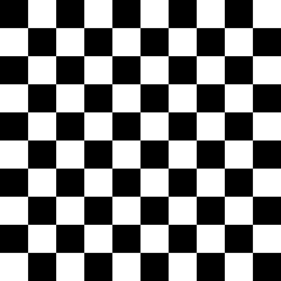
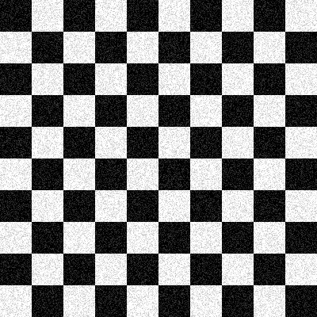
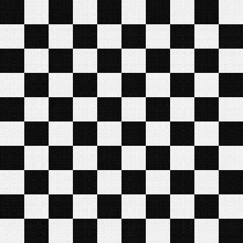
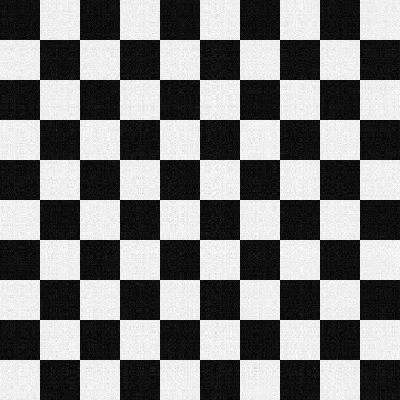

# Challenge 2 — SVD and Image Compression

**Authors**

- Yahia Ghallale (10965385)
- Enrico Jin (10890225)
- Beatrice Lollio (11256228)

This project completes tasks 1–13 of the Numerical Linear Algebra Challenge 2. The implementation follows the Challenge 1 pattern: numbered task blocks in `challenge.cpp`, Eigen matrices and vectors, `stb_image` image input, and printed results. It uses the grayscale `deer.jpg` from Challenge 1.

## Input and generated files

Place `deer.jpg` in the project directory. Run `challenge` from that directory. It reads the image, writes `AtA.mtx`, runs the LIS eigenvalue calculation, and prints the results for tasks 1–13. It also writes the compressed deer images, the original and noisy checkerboards, and the rank-6 and rank-12 checkerboard reconstructions as PNG files.

## Tasks completed

1. Load the image into Eigen matrix `A` and report the Euclidean norm of `A^T A`.
2. Solve the symmetric eigenvalue problem for `A^T A`; report the two largest singular values as the square roots of its two largest eigenvalues.
3. Export `A^T A` as `AtA.mtx` in Matrix Market coordinate format for LIS.
4. Run LIS's power eigensolver both without a shift and with `mu = lambda2 / 2`, and report the eigenvalue and iteration count for both runs. The shifted run also prints its residual.
5. Compute the thin SVD of `A` with Eigen and report `||Sigma||_2` as the Euclidean norm of its singular-value vector.
6. Form `C = U_k` and `D = V_k Sigma_k` for `k = 30` and `k = 90`, and report their nonzero entry counts.
7. Reconstruct the deer image with `k = 30, 90` and export `compressed_image_1.png` and `compressed_image_2.png`.
8. Create a 400 × 400 checkerboard with 40 × 40 squares, report its Frobenius norm, and save `checkerboard.png`.
9. Add random noise in `[-60, 60]`, clip the noisy pixels to `[0, 255]`, and save `noisy_checkerboard.png`.
10. Compute the thin SVD of the clipped floating-point noisy matrix and report its two largest singular values.
11. Form C and D for `k = 6, 12` and report their dimensions: both are 400 × 6 or 400 × 12, respectively.
12. Export `compressed_checkerboard_k6.png` and `compressed_checkerboard_k12.png`.
13. Compare the reconstructions with the original and noisy checkerboards using RMSE and the discussion below.

## Results

The grayscale deer image is **656 × 656** pixels. The following values were reported by the completed run:

| Task | Result |
| --- | --- |
| 1 | `A^T A` Euclidean norm: `1,210,497,678.444907188416` |
| 2 | Largest singular value: `34,645.143595853711`; second largest: `10,623.769487838059` |
| 3 | `A^T A` exported to `AtA.mtx`; `430,336` nonzero entries |
| 4 | LIS largest eigenvalue: `1,200,285,974.777324438095`; no shift: 10 iterations, residual `8.349e-11`; shift `mu = 56,432,239.065359473228`: 9 iterations, residual `7.195e-12` |
| 5 | Euclidean norm of `Sigma`: `41,415.341203476681` |
| 6 | `k=30`: `C` and `D` each have `19,680` nonzero entries; `k=90`: each has `59,040` |

The shifted LIS eigenvalue was `1,200,285,974.777323246002`, agreeing with the unshifted value to the displayed precision. The shift reduced the iteration count by one.

## Build and run

Use the course container, as for Challenge 1:

```bash
source /u/sw/etc/bash.bashrc
module load gcc-glibc
module load lis
LIS_HOME=/u/sw/toolchains/gcc-glibc/11.2.0/pkgs/lis/2.0.30
g++ -O2 -std=c++17 -DHAVE_CONFIG_H -DUSE_MPI -I"$mkEigenInc" -I"$LIS_HOME/include" challenge.cpp \
  -L"$LIS_HOME/lib" -Wl,-rpath,"$LIS_HOME/lib" -llis -lmpi -o challenge
./challenge
```

Task 4 runs through LIS's C API from `challenge.cpp`; it does not require `etest5` or a manual copy of `AtA.mtx`. The program uses `mu = lambda2 / 2` and prints the baseline and shifted iteration counts for comparison. LIS reports the original largest eigenvalue alongside its shifted iteration run.

## Notes

`A^T A` is 656 × 656 for the deer image (at most 430,336 entries), so its Matrix Market export is practical. The Eigen eigenvalue and SVD calculations are dense and may take longer than the image operations.


## Noise and image conversion

The noisy matrix is clipped to `[0, 255]` before its SVD, consistently with task 9. This introduces a bias: black pixels become brighter on average, and white pixels become darker. PNG export clamps and truncates values to 8-bit grayscale without modifying the floating-point source matrix. Reported RMSE values refer to those floating-point matrices before PNG conversion.

The program does not seed `rand()`, so runs are repeatable with the same C runtime; the random sequence can differ across platforms. The original checkerboard has rank 2. Keeping 6 or 12 singular components preserves its main pattern while discarding part of the noise; keeping more components also retains more noise.

## Checkerboard results and comparison (tasks 8–13)

Measured in the course container (`quay.io/pjbaioni/amsc_mk:2025`):

- Original checkerboard Frobenius norm: **72124.891681**.
- Largest noisy-image singular values: **51012.027685599613** and **45010.442702636152**.
- At `k = 6`, C and D are both **400 × 6**; at `k = 12`, both are **400 × 12**.

| Image / reconstruction | RMSE versus original | RMSE versus noisy matrix |
| --- | ---: | ---: |
| Noisy checkerboard | 24.459253292664 | 0 |
| Rank 6 | 15.565789637580 | 18.866975307764 |
| Rank 12 | 16.187107230792 | 18.336692794053 |

Both reconstructions visibly suppress the speckled noise and retain the square boundaries. The rank-6 image is smoother and closer to the clean original. Rank 12 better approximates the noisy matrix, as expected from truncated SVD, but retains more noise and therefore has a slightly larger error against the clean original. The remaining loss of contrast (dark gray instead of pure black, light gray instead of pure white) is consistent with the clipping bias. Increasing the rank improves approximation of the input; it does not necessarily improve denoising.






## Regression checks

Using the same compiler flags and libraries as above, replace `challenge.cpp` with `test_challenge.cpp` and `-o challenge` with `-o /tmp/test_challenge`, then run `/tmp/test_challenge`. Build without `-DNDEBUG` so assertions remain enabled. These checks cover invalid ranks, reconstruction, the checkerboard norm/pattern, and PNG buffer conversion without source-matrix mutation.
